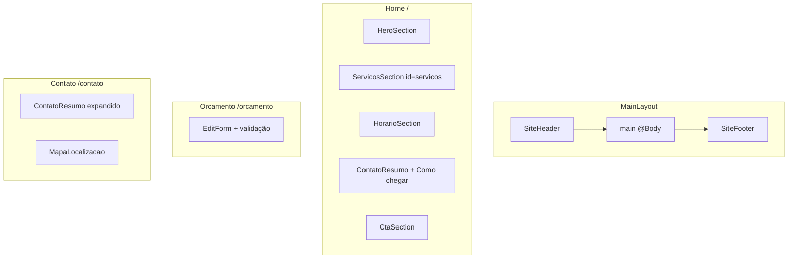

# Plano de Implementação — MVP Visual Oficina.Web

## Escopo desta etapa

Transformar o template atual em um site institucional completo com **interface, navegação, componentização, UX/UI e conteúdo fictício**. Sem banco, API, auth, Radzen ou novas bibliotecas.

**Fora do escopo:** envio real do formulário para WhatsApp (apenas UI preparada), dados reais da oficina, README (não solicitado nesta etapa).

---

## Decisões técnicas adotadas

| Decisão | Escolha | Motivo |
|---------|---------|--------|
| Conteúdo fictício | `appsettings.json` + `Models/OficinaSettings.cs` | Centralizado, substituível sem editar componentes |
| Layout | Header → Main → Footer | Sidebar inadequada para vitrine mobile-first |
| Render mode | SSR estático em Home, Contato, Error, NotFound | Performance, simplicidade |
| Formulário `/orcamento` | `InteractiveServer` + `EditForm` | Única página que precisa de validação interativa clara; submit prepara UI sem enviar dados |
| Navegação | Páginas separadas (`/`, `/orcamento`, `/contato`) | Conforme especificação; links de serviços na Home usam âncora `#servicos` |
| NavMenu | Remover; substituir por `SiteHeader.razor` | Navbar Bootstrap no topo, sem sidebar |
| Mapa | iframe Google Maps placeholder | Substituível via config quando houver endereço real |
| Ícones/ilustrações | SVG inline ou arquivos em `wwwroot/images/` | Leves, substituíveis |
| Program.cs | Alteração mínima: registrar `OficinaSettings` | Necessário para injetar config nos componentes |
| Horário aberto/fechado | Lógica simples server-side (hora atual vs. config) | Sem complexidade; badge visual opcional |

---

## Inventário de arquivos

### Arquivos a MODIFICAR (11)

| Arquivo | Motivo |
|---------|--------|
| [`Program.cs`](Program.cs) | Registrar `OficinaSettings` via `Configure<OficinaSettings>` para `@inject IOptions<OficinaSettings>` |
| [`appsettings.json`](appsettings.json) | Adicionar seção `Oficina` com todos os dados fictícios (Barretos/SP) |
| [`Components/App.razor`](Components/App.razor) | `lang="pt-BR"`, favicon SVG, meta description padrão |
| [`Components/_Imports.razor`](Components/_Imports.razor) | Usings: `Oficina.Web.Models`, `Oficina.Web.Components.Shared`, `Microsoft.Extensions.Options` |
| [`Components/Layout/MainLayout.razor`](Components/Layout/MainLayout.razor) | Trocar sidebar por `SiteHeader` + `@Body` + `SiteFooter`; textos PT-BR no error-ui |
| [`Components/Layout/MainLayout.razor.css`](Components/Layout/MainLayout.razor.css) | Remover estilos de sidebar; layout vertical mobile-first |
| [`Components/Pages/Home.razor`](Components/Pages/Home.razor) | Compor seções: Hero, Serviços, Horário, Localização, CTA final |
| [`Components/Pages/Error.razor`](Components/Pages/Error.razor) | Textos em português brasileiro |
| [`Components/Pages/NotFound.razor`](Components/Pages/NotFound.razor) | Textos PT-BR + link "Voltar ao início" |
| [`wwwroot/app.css`](wwwroot/app.css) | Variáveis CSS, overrides Bootstrap, utilitários de tema |
| [`Components/Layout/ReconnectModal.razor`](Components/Layout/ReconnectModal.razor) | Traduzir mensagens para PT-BR (infra Blazor) |

### Arquivos NOVOS (22)

**Models/**
| Arquivo | Motivo |
|---------|--------|
| `Models/OficinaSettings.cs` | Classe raiz de configuração |
| `Models/ServicoItem.cs` | Item de serviço (nome, descrição, ícone) |
| `Models/HorarioItem.cs` | Item de horário (dia, período) |

**Layout/**
| Arquivo | Motivo |
|---------|--------|
| `Components/Layout/SiteHeader.razor` | Navbar mobile-first com logo, links, CTA WhatsApp |
| `Components/Layout/SiteHeader.razor.css` | Estilos scoped do header |
| `Components/Layout/SiteFooter.razor` | Rodapé com telefone, WhatsApp, endereço, copyright |
| `Components/Layout/SiteFooter.razor.css` | Estilos scoped do footer |

**Shared/**
| Arquivo | Motivo |
|---------|--------|
| `Components/Shared/HeroSection.razor` | Banner principal da Home |
| `Components/Shared/ServicosSection.razor` | Grid de cards de serviços |
| `Components/Shared/HorarioSection.razor` | Tabela/lista de horários + badge aberto/fechado |
| `Components/Shared/ContatoResumo.razor` | Endereço, telefone, referência (reutilizado Home/Contato) |
| `Components/Shared/WhatsAppButton.razor` | Botão/link verde `#25D366` reutilizável |
| `Components/Shared/MapaLocalizacao.razor` | iframe Google Maps placeholder |
| `Components/Shared/CtaSection.razor` | CTA final (orçamento + WhatsApp) na Home |

**Pages/**
| Arquivo | Motivo |
|---------|--------|
| `Components/Pages/Orcamento.razor` | Formulário mobile-first com validação |
| `Components/Pages/Contato.razor` | Página de contato completa |

**Estáticos**
| Arquivo | Motivo |
|---------|--------|
| `wwwroot/images/logo.svg` | Logo fictício substituível |
| `wwwroot/images/favicon.svg` | Favicon (substitui referência PNG inexistente) |
| `wwwroot/images/icons/*.svg` | Ícones de serviços (óleo, freios, alinhamento, etc.) |

**Helpers (opcional, mínimo)**
| Arquivo | Motivo |
|---------|--------|
| `Models/OrcamentoFormModel.cs` | Model do formulário com DataAnnotations |

### Arquivos a REMOVER (4)

| Arquivo | Motivo |
|---------|--------|
| [`Components/Pages/Counter.razor`](Components/Pages/Counter.razor) | Demo template, sem uso no MVP |
| [`Components/Pages/Weather.razor`](Components/Pages/Weather.razor) | Demo template, sem uso no MVP |
| [`Components/Layout/NavMenu.razor`](Components/Layout/NavMenu.razor) | Substituído por `SiteHeader.razor` |
| [`Components/Layout/NavMenu.razor.css`](Components/Layout/NavMenu.razor.css) | CSS da sidebar removida |

### Arquivos MANTIDOS sem alteração estrutural

- [`Components/Routes.razor`](Components/Routes.razor) — router funciona automaticamente com novas `@page`
- [`Oficina.Web.csproj`](Oficina.Web.csproj) — sem pacotes novos
- [`appsettings.Development.json`](appsettings.Development.json) — logging apenas
- `ReconnectModal.razor.css` + `.js` — infra SignalR

---

## Conteúdo fictício centralizado

Dados de exemplo em `appsettings.json` (Barretos/SP):

```json
"Oficina": {
  "Nome": "Auto Mecânica Barretos",
  "NomeCurto": "Auto Mecânica Barretos",
  "Descricao": "Manutenção preventiva e corretiva com atendimento honesto e transparente.",
  "Cidade": "Barretos",
  "Estado": "SP",
  "Telefone": "(17) 3321-0000",
  "WhatsApp": "5517332100000",
  "Endereco": "Av. Exemplo, 1500 — Centro",
  "PontoReferencia": "Próximo ao Hospital de Amor",
  "Cep": "14780-000",
  "GoogleMapsEmbedUrl": "https://maps.google.com/maps?q=Barretos,SP&output=embed",
  "GoogleMapsDirectionsUrl": "https://maps.google.com/maps?q=Barretos,SP",
  "MetaDescription": "Oficina mecânica em Barretos/SP. Manutenção, freios, suspensão e diagnóstico. Solicite orçamento pelo WhatsApp.",
  "Horarios": [ ... ],
  "Servicos": [ ... ]
}
```

Componentes recebem dados via `@inject IOptions<OficinaSettings> Oficina` ou `[Parameter]` quando reutilizados com props explícitas.

---

## Identidade visual (`wwwroot/app.css`)

```css
:root {
  --cor-principal: #1E3A8A;
  --cor-destaque: #F59E0B;
  --cor-fundo: #F9FAFB;
  --cor-whatsapp: #25D366;
  --cor-texto: #1F2937;
}
```

- **Azul `#1E3A8A`:** header, títulos, footer, elementos estruturais
- **Âmbar `#F59E0B`:** botões CTA principais ("Solicitar Orçamento")
- **Verde `#25D366`:** exclusivamente ações WhatsApp
- **Fundo `#F9FAFB`:** body e seções alternadas
- Override de `.btn-primary` para azul; classe `.btn-whatsapp` para verde
- Foco visível (`:focus-visible`) para acessibilidade

---

## Estrutura de layout



### SiteHeader.razor
- Navbar Bootstrap `navbar-expand-lg`, sticky top
- Logo SVG + nome da oficina
- Links: Início, Serviços (`/#servicos`), Orçamento, Contato
- Botão WhatsApp (verde) visível em desktop; no mobile dentro do collapse
- Toggle hamburger via Bootstrap collapse (sem JS customizado — usa `data-bs-toggle` do Bootstrap bundle se necessário, ou checkbox CSS como fallback)

**Nota:** Bootstrap JS não está carregado em `App.razor` atualmente. Usaremos **collapse via checkbox CSS** (padrão já existente no NavMenu) para evitar adicionar JavaScript.

### SiteFooter.razor
- Fundo azul escuro, texto claro
- Telefone, WhatsApp, endereço
- Copyright com ano dinâmico (`DateTime.Now.Year`)

---

## Páginas

### Home (`/`)
Composição pura de componentes Shared — sem lógica de negócio:

1. `HeroSection` — nome, descrição, "Barretos/SP", CTA orçamento (âmbar) + WhatsApp (verde)
2. `ServicosSection` — 6 cards com ícone SVG, nome, descrição; grid `col-12 col-md-6 col-lg-4`
3. `HorarioSection` — lista de horários + badge "Aberto agora" / "Fechado" (lógica simples)
4. Seção localização — `ContatoResumo` + link "Como chegar"
5. `CtaSection` — bloco final com dois botões

SEO: `<PageTitle>`, `<HeadContent>` com meta description.

### Orçamento (`/orcamento`)
- `@rendermode InteractiveServer` — justificado para `EditForm` + validação
- Campos: Nome, Telefone, Veículo, Placa, Descrição
- `OrcamentoFormModel` com `[Required]`, `[Phone]`, `[StringLength]`
- Labels visíveis, inputs grandes (`form-control-lg`), `ValidationMessage`
- Botão submit desabilitado ou com mensagem informativa: *"Integração com WhatsApp em breve"* — **não envia dados**
- Layout single-column, max-width confortável no mobile

### Contato (`/contato`)
- SSR estático
- `ContatoResumo` expandido (telefone clicável `tel:`, WhatsApp, endereço, referência)
- Botão "Como chegar" → `GoogleMapsDirectionsUrl`
- `MapaLocalizacao` — iframe responsivo (`ratio ratio-16x9`)

---

## Componentes Shared — contratos

| Componente | Parâmetros / Injeção |
|------------|---------------------|
| `HeroSection` | `@inject IOptions<OficinaSettings>` |
| `ServicosSection` | `[Parameter] IEnumerable<ServicoItem> Servicos` |
| `HorarioSection` | `[Parameter] IEnumerable<HorarioItem> Horarios` + lógica aberto/fechado interna |
| `ContatoResumo` | `[Parameter] bool ShowTelefone`, `ShowReferencia` |
| `WhatsAppButton` | `[Parameter] string Text`, `CssClass`, `Message` (opcional) |
| `MapaLocalizacao` | `[Parameter] string EmbedUrl` |
| `CtaSection` | `@inject IOptions<OficinaSettings>` |

Sem regras de negócio — apenas apresentação e helpers mínimos (ex.: montar URL `wa.me`).

---

## SEO e acessibilidade

- `lang="pt-BR"` em App.razor
- `<PageTitle>` único por página
- `<HeadContent>` com `<meta name="description">` por página
- Hierarquia: um `<h1>` por página, `<h2>` por seção
- `alt` em SVGs decorativos via `aria-hidden="true"`; imagens informativas com alt
- Labels associados a inputs (`for`/`id`)
- Contraste WCAG: texto branco sobre azul `#1E3A8A`, botões com texto escuro sobre âmbar
- `FocusOnNavigate` já presente em Routes.razor
- Links externos com `rel="noopener noreferrer"`

---

## Ordem de execução (após confirmação)

```text
Fase 1 — Fundação
  1. Models/ (OficinaSettings, ServicoItem, HorarioItem, OrcamentoFormModel)
  2. appsettings.json (seção Oficina)
  3. Program.cs (Configure<OficinaSettings>)
  4. _Imports.razor
  5. wwwroot/app.css (variáveis + overrides)

Fase 2 — Layout
  6. SiteHeader.razor + CSS
  7. SiteFooter.razor + CSS
  8. MainLayout.razor + CSS (refatorar)
  9. Remover NavMenu.razor + NavMenu.razor.css

Fase 3 — Shared
  10. WhatsAppButton.razor
  11. HeroSection, ServicosSection, HorarioSection
  12. ContatoResumo, MapaLocalizacao, CtaSection
  13. SVGs (logo, favicon, ícones de serviços)

Fase 4 — Páginas
  14. Home.razor (composição)
  15. Orcamento.razor (formulário)
  16. Contato.razor

Fase 5 — Shell e limpeza
  17. App.razor (lang, favicon, meta)
  18. Error.razor + NotFound.razor (PT-BR)
  19. ReconnectModal.razor (PT-BR)
  20. Remover Counter.razor + Weather.razor

Fase 6 — Verificação
  21. dotnet build
  22. Revisão visual mobile/desktop
```

---

## Resultado esperado ao final

- Site visualmente completo com identidade azul/âmbar/verde WhatsApp
- 3 rotas funcionais: `/`, `/orcamento`, `/contato`
- Header sticky + footer + navegação mobile
- Home com 7 seções (hero, serviços, horário, localização, CTA, header, footer)
- Formulário de orçamento com validação visual (sem envio)
- Página de contato com mapa iframe
- Conteúdo fictício centralizado em `appsettings.json`
- Template limpo (Counter/Weather/NavMenu removidos)
- SEO e acessibilidade básicos
- Zero pacotes novos, zero banco, zero API
