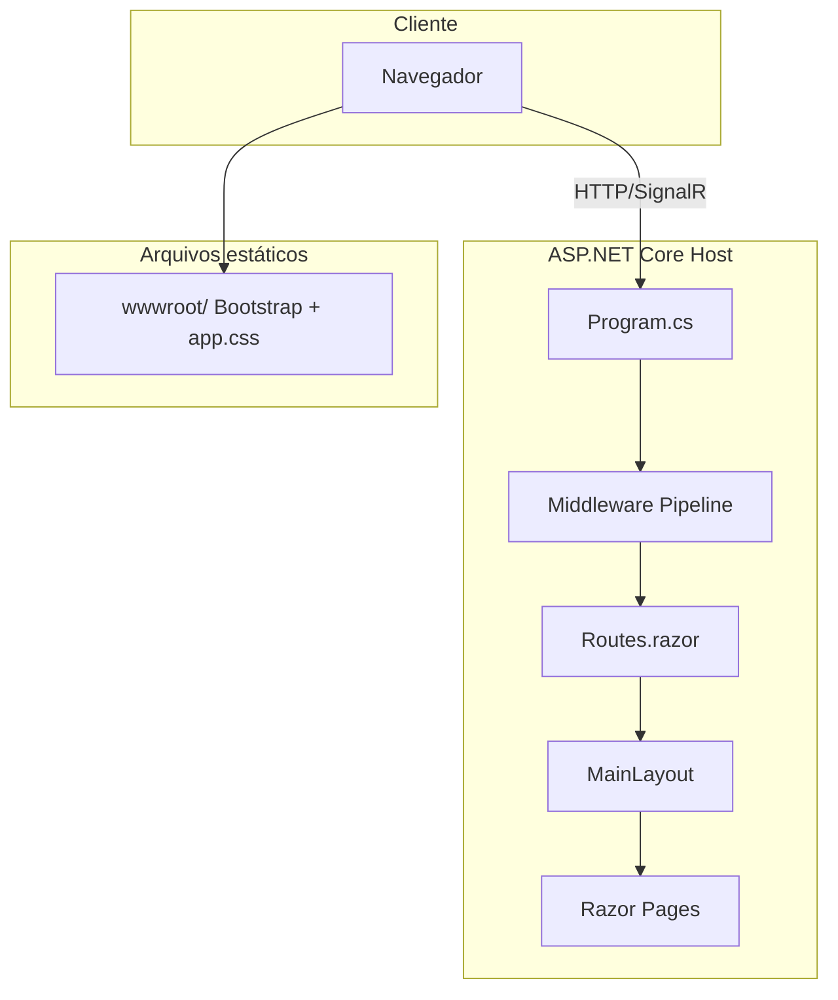
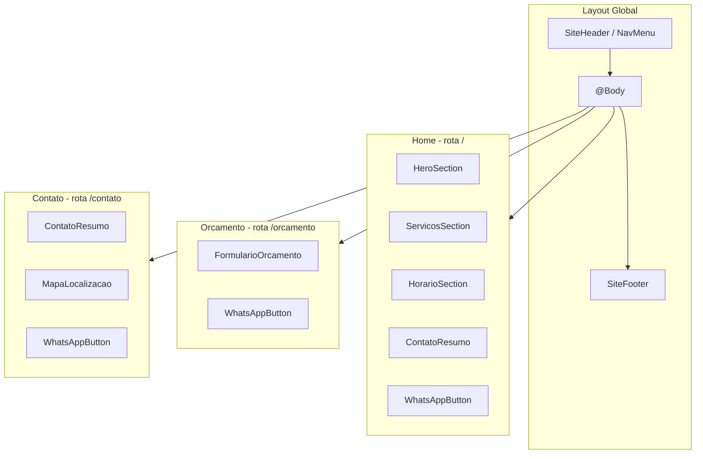

# Análise do Estado Atual — Oficina.Web

## Resumo executivo

O projeto é um **Blazor Web App** (.NET 10) gerado pelo template padrão, com **uma única customização funcional**: [`Components/Pages/Home.razor`](Components/Pages/Home.razor) foi parcialmente adaptada para a oficina. Todo o restante — layout, navegação, estilos e páginas auxiliares — ainda reflete o template Microsoft. O README é extenso e documenta intenções futuras, mas o código ainda não implementa serviços, horário, endereço, WhatsApp real, orçamento ou contato.

---

## 1. Qual é a arquitetura atual?

**Arquitetura monolítica de projeto único**, sem camadas, sem banco de dados, sem serviços de domínio.



| Camada | Onde está | Papel |
|--------|-----------|-------|
| Host / bootstrap | [`Program.cs`](Program.cs) | Configura serviços, pipeline HTTP, mapeia componentes |
| Shell HTML | [`Components/App.razor`](Components/App.razor) | Documento HTML raiz (`<html>`, CSS, scripts) |
| Roteamento | [`Components/Routes.razor`](Components/Routes.razor) | Router Blazor + layout padrão |
| Layout | [`Components/Layout/`](Components/Layout/) | Sidebar + área de conteúdo |
| Páginas | [`Components/Pages/`](Components/Pages/) | Rotas da aplicação |
| Estáticos | [`wwwroot/`](wwwroot/) | Bootstrap 5.3.3 + CSS global |
| Config | [`appsettings.json`](appsettings.json) | Apenas logging (sem dados da oficina) |

Não há pastas `Models/`, `Services/`, `Data/` ou testes. É o modelo **"template Blazor Web App"** — adequado para um MVP simples.

---

## 2. Como o Blazor está configurado?

Tipo: **Blazor Web App** com **Interactive Server** habilitado globalmente.

Em [`Program.cs`](Program.cs):

```csharp
builder.Services.AddRazorComponents()
    .AddInteractiveServerComponents();
// ...
app.MapRazorComponents<App>()
    .AddInteractiveServerRenderMode();
```

Comportamento por página hoje:

| Página | Render mode | Observação |
|--------|-------------|--------------|
| `Home.razor` | Estático (SSR) | Sem `@rendermode` — HTML gerado no servidor, sem SignalR |
| `Counter.razor` | `InteractiveServer` | Template demo — requer circuito SignalR |
| `Weather.razor` | `StreamRendering` | Template demo — streaming SSR |
| `Error.razor` / `NotFound.razor` | Estático | Infraestrutura |

Recursos do template ainda ativos:
- [`ReconnectModal.razor`](Components/Layout/ReconnectModal.razor) — reconexão SignalR
- `MapStaticAssets()` — pipeline de assets estáticos do .NET 10
- `UseAntiforgery()` — proteção CSRF (relevante se houver formulários POST futuros)
- `BlazorDisableThrowNavigationException` no `.csproj` — suprime exceções de navegação

**Implicação para o MVP:** a maioria das páginas (Home, Contato, Orçamento) pode permanecer **estática/SSR**, sem interatividade SignalR. Apenas o formulário de orçamento precisará decidir entre link WhatsApp (estático) ou `@rendermode InteractiveServer` (validação client-side).

---

## 3. Qual é o papel de Program.cs?

[`Program.cs`](Program.cs) é o **ponto de entrada** da aplicação ASP.NET Core. Responsabilidades atuais:

1. **Registro de serviços** — `AddRazorComponents()` + `AddInteractiveServerComponents()`
2. **Pipeline HTTP** — exceções, HSTS (produção), redirecionamento HTTPS, antiforgery
3. **Páginas de erro** — `/Error` (500), `/not-found` (404)
4. **Mapeamento de componentes** — `MapRazorComponents<App>()` como root component
5. **Assets estáticos** — `MapStaticAssets()`

Não registra banco, autenticação, APIs ou serviços customizados. Para o MVP, aqui entrariam apenas serviços leves (ex.: leitura de configuração da oficina via `IOptions<OficinaSettings>`).

---

## 4. Qual é o papel de App.razor?

[`Components/App.razor`](Components/App.razor) **não é um componente visual comum** — é o **documento HTML raiz** da aplicação (substitui o antigo `_Host.cshtml` / `index.html`).

Responsabilidades:
- Define `<html>`, `<head>`, `<body>`
- Carrega Bootstrap, `app.css` e CSS scoped do projeto (`Oficina.Web.styles.css`)
- Referencia `favicon.png`, `ImportMap`, `ResourcePreloader` (recursos .NET 10)
- Renderiza `<Routes />` (roteador) e `<ReconnectModal />` (SignalR)
- Carrega `blazor.web.js`

**Problemas atuais para o MVP:**
- `lang="en"` — deveria ser `lang="pt-BR"`
- Referencia `favicon.png` que **não existe** no repositório
- Sem meta tags SEO (`description`, Open Graph)
- Sem variáveis CSS da identidade visual (azul escuro / âmbar)

---

## 5. Qual é o papel de Routes.razor?

[`Components/Routes.razor`](Components/Routes.razor) configura o **roteador Blazor**:

```razor
<Router AppAssembly="typeof(Program).Assembly" NotFoundPage="typeof(Pages.NotFound)">
    <Found Context="routeData">
        <RouteView RouteData="routeData" DefaultLayout="typeof(Layout.MainLayout)" />
        <FocusOnNavigate RouteData="routeData" Selector="h1" />
    </Found>
</Router>
```

- Descobre rotas via `@page` directives nos `.razor` do assembly
- Aplica `MainLayout` como layout padrão em todas as páginas
- Redireciona 404 para `NotFound.razor` (via middleware + `NotFoundPage`)
- `FocusOnNavigate` — acessibilidade: foco no `<h1>` após navegação

Para o MVP: **não precisa mudar estruturalmente** — novas páginas entram automaticamente ao adicionar `@page "/rota"`.

---

## 6. Como o MainLayout funciona?

[`Components/Layout/MainLayout.razor`](Components/Layout/MainLayout.razor) herda `LayoutComponentBase` e define a **estrutura visual global**:

```
┌─────────────────────────────────────────┐
│ sidebar (NavMenu)  │  main             │
│                    │  ┌───────────────┐│
│  - Home            │  │ top-row       ││
│  - Counter         │  │ (link About)  ││
│  - Weather         │  ├───────────────┤│
│                    │  │ @Body         ││
│                    │  │ (conteúdo)    ││
│                    │  └───────────────┘│
└─────────────────────────────────────────┘
```

- **`@Body`** — placeholder onde o conteúdo da página é renderizado
- **Sidebar fixa** (250px, sticky) em telas >= 641px — padrão template admin/dashboard
- **`top-row`** — link "About" para documentação Microsoft (resíduo do template)
- **`#blazor-error-ui`** — banner de erro não tratado

CSS em [`MainLayout.razor.css`](Components/Layout/MainLayout.razor.css): gradiente roxo/azul na sidebar, layout flex row/column responsivo.

**Incompatibilidade com o MVP mobile-first:** o layout sidebar lateral é pensado para apps internas, não para site vitrine de oficina. Para o MVP, o layout deve migrar para **header + conteúdo + footer** (navbar Bootstrap no topo), eliminando a sidebar.

---

## 7. Como o NavMenu funciona?

[`Components/Layout/NavMenu.razor`](Components/Layout/NavMenu.razor) + [`NavMenu.razor.css`](Components/Layout/NavMenu.razor.css):

- **Brand:** "Oficina.Web" (nome técnico do projeto, não da oficina)
- **Toggle mobile:** checkbox CSS hack (sem JavaScript) — hamburger em telas pequenas
- **Links atuais:** Home, Counter, Weather — todos do template, exceto Home
- **Ícones:** SVG inline via classes `.bi-*` (Bootstrap Icons embarcados no CSS)
- **`NavLink`** com `Match="NavLinkMatch.All"` na Home — destaca rota exata `/`

Comportamento responsivo:
- Mobile (< 641px): menu colapsado, expande ao clicar toggler
- Desktop: menu sempre visível na sidebar

**Para o MVP:** substituir links por Início, Serviços (ou seção na Home), Solicitar Orçamento, Contato; mover de sidebar para navbar horizontal; adicionar CTA WhatsApp fixo.

---

## 8. Quais páginas ainda pertencem ao template padrão?

| Arquivo | Rota | Status |
|---------|------|--------|
| [`Counter.razor`](Components/Pages/Counter.razor) | `/counter` | **100% template** — demo interatividade |
| [`Weather.razor`](Components/Pages/Weather.razor) | `/weather` | **100% template** — demo streaming + dados fake |
| [`Error.razor`](Components/Pages/Error.razor) | `/Error` | **Template** — manter, adaptar textos para PT-BR |
| [`NotFound.razor`](Components/Pages/NotFound.razor) | `/not-found` | **Template** — manter, adaptar textos e estilo |
| [`Home.razor`](Components/Pages/Home.razor) | `/` | **Parcialmente customizada** — título e CTA placeholder, sem WhatsApp real, sem seções |

Páginas **inexistentes** (necessárias para o MVP):
- `/orcamento` — Solicitar Orçamento
- `/contato` — Contato e Localização

---

## 9. Quais arquivos deverão ser modificados para construir o MVP?

### Essenciais (layout e navegação)

- [`Components/Layout/MainLayout.razor`](Components/Layout/MainLayout.razor) — trocar sidebar por header/footer
- [`Components/Layout/MainLayout.razor.css`](Components/Layout/MainLayout.razor.css) — novo layout mobile-first
- [`Components/Layout/NavMenu.razor`](Components/Layout/NavMenu.razor) — links do MVP, brand da oficina
- [`Components/Layout/NavMenu.razor.css`](Components/Layout/NavMenu.razor.css) — estilo navbar (não sidebar)

### Páginas

- [`Components/Pages/Home.razor`](Components/Pages/Home.razor) — hero, serviços, horário, endereço, CTA WhatsApp
- [`Components/Pages/Error.razor`](Components/Pages/Error.razor) — textos em português
- [`Components/Pages/NotFound.razor`](Components/Pages/NotFound.razor) — textos em português + link voltar

### Shell e estilos

- [`Components/App.razor`](Components/App.razor) — `lang="pt-BR"`, meta SEO, favicon
- [`wwwroot/app.css`](wwwroot/app.css) — variáveis CSS (azul `#0F2027`/`#1E3A8A`, âmbar `#FBBF24`/`#F59E0B`, fundo `#F9FAFB`), override Bootstrap
- [`Components/_Imports.razor`](Components/_Imports.razor) — usings para novos namespaces

### Configuração

- [`appsettings.json`](appsettings.json) — seção `Oficina` com nome, telefone, WhatsApp, endereço, horário, serviços
- [`Program.cs`](Program.cs) — bind de `OficinaSettings` via `IOptions` (opcional mas recomendado)

### Documentação

- [`README.md`](README.md) — alinhar com estado real pós-implementação (já extenso, precisa refletir código)

---

## 10. Quais arquivos podem ser removidos?

| Arquivo | Motivo |
|---------|--------|
| [`Components/Pages/Counter.razor`](Components/Pages/Counter.razor) | Demo template, sem uso no MVP |
| [`Components/Pages/Weather.razor`](Components/Pages/Weather.razor) | Demo template, sem uso no MVP |

**Manter (infraestrutura Blazor):**
- `ReconnectModal.razor` + `.css` + `.js` — necessário se alguma página usar Interactive Server
- `Error.razor`, `NotFound.razor` — tratamento de erros

**Opcional remover do wwwroot** (reduzir tamanho, não urgente):
- Bootstrap RTL, grid separado, reboot separado — o App.razor usa apenas `bootstrap.min.css`

---

## 11. Quais arquivos novos recomendo criar?

### Páginas

- `Components/Pages/Orcamento.razor` — formulário → monta URL WhatsApp
- `Components/Pages/Contato.razor` — telefone, endereço, mapa embed/link

### Componentes reutilizáveis

- `Components/Shared/HeroSection.razor` — banner principal da Home
- `Components/Shared/ServicosSection.razor` — grid de serviços
- `Components/Shared/HorarioSection.razor` — horário de funcionamento
- `Components/Shared/ContatoResumo.razor` — endereço + WhatsApp (usado na Home e Contato)
- `Components/Shared/WhatsAppButton.razor` — botão/link reutilizável
- `Components/Shared/SiteFooter.razor` — rodapé com contato

### Dados / configuração (sem banco)

- `Models/OficinaSettings.cs` — record/class tipada para config
- `Models/Servico.cs` — nome + descrição + ícone (opcional)

### Estáticos

- `wwwroot/images/favicon.png` (ou `.svg`) — ícone da oficina
- `wwwroot/css/theme.css` — variáveis e tokens visuais (alternativa: tudo em `app.css`)

### Layout (se separar header/footer do NavMenu)

- `Components/Layout/SiteHeader.razor` — navbar + CTA
- `Components/Layout/SiteFooter.razor` — rodapé (ou mover para Shared)

**Não recomendo agora:** pastas `Services/`, `Data/`, controllers API, banco, autenticação.

---

## 12. Problemas técnicos e decisões arquiteturais a resolver antes da implementação

### Decisões de produto (bloqueiam implementação)

1. **Dados reais da oficina** — nome comercial, telefone/WhatsApp (formato internacional), endereço completo, horário, lista de serviços, link Google Maps
2. **Nome da marca** — "Oficina Mecânica" genérico vs. nome real
3. **Estrutura de navegação** — páginas separadas (`/orcamento`, `/contato`) vs. single-page com âncoras (`/#servicos`, `/#contato`)

### Decisões técnicas

4. **Layout: sidebar → navbar** — o layout atual é incompatível com vitrine mobile-first; deve ser refatorado antes de estilizar páginas
5. **Render mode do formulário de orçamento:**
   - **Opção A (recomendada):** SSR estático + JavaScript mínimo ou link `<a>` com URL WhatsApp montada via `@onclick`/`InteractiveServer`
   - **Opção B:** `InteractiveServer` com validação Blazor (`EditForm` + `DataAnnotations`)
   - Para MVP: **Opção A** é mais simples e não depende de SignalR
6. **Onde guardar conteúdo:**
   - **Opção A (recomendada):** `appsettings.json` → fácil alterar sem recompilar lógica
   - **Opção B:** constantes em classe C# estática → mais simples ainda, menos flexível
7. **Integração WhatsApp:** URL `https://wa.me/55XXXXXXXXXXX?text=...` com mensagem URL-encoded — sem backend
8. **Mapa:** iframe Google Maps embed vs. link "Como chegar" — iframe é mais rico, link é mais leve
9. **Idioma:** todo conteúdo e `lang="pt-BR"` — incluindo Error/NotFound/ReconnectModal
10. **SEO básico:** `<PageTitle>`, meta description, heading hierarchy — importante para cliente encontrar a oficina

### Problemas técnicos existentes

- **`favicon.png` ausente** — referenciado em App.razor mas não existe no repo
- **Botão WhatsApp com `href="#"`** — placeholder não funcional em Home.razor
- **Textos em inglês** — Error, NotFound, ReconnectModal, blazor-error-ui, `lang="en"`
- **Link "About"** apontando para Microsoft Docs — resíduo do template

---

## 13. Como estruturaria os componentes da interface?

Abordagem: **composição por seções reutilizáveis**, mobile-first, Bootstrap grid.



### Hierarquia visual (mobile-first)

1. **Header fixo/sticky** — logo/nome + hamburger + CTA WhatsApp
2. **Hero** — nome, tagline, botão principal
3. **Serviços** — cards 1 coluna (mobile) → 2-3 colunas (desktop)
4. **Horário + Endereço** — blocos compactos
5. **CTA final** — "Solicitar Orçamento" + WhatsApp
6. **Footer** — repetição de contato, copyright

### Padrões de componente

- **Presentational (.razor)** — recebem dados via `[Parameter]`, sem lógica de negócio
- **Config centralizada** — `OficinaSettings` injetada via `@inject IOptions<OficinaSettings>`
- **CSS scoped** (`.razor.css`) por componente + variáveis globais em `app.css`
- **Bootstrap utilities** para spacing/responsividade; CSS customizado só para identidade visual

---

## Proposta de estrutura de pastas para o MVP

```text
Oficina.Web/
│
├── Components/
│   ├── App.razor
│   ├── Routes.razor
│   ├── _Imports.razor
│   │
│   ├── Layout/
│   │   ├── MainLayout.razor          (refatorar: header + main + footer)
│   │   ├── MainLayout.razor.css
│   │   ├── SiteHeader.razor          (NOVO — navbar mobile-first)
│   │   ├── SiteHeader.razor.css
│   │   ├── SiteFooter.razor          (NOVO — rodapé)
│   │   ├── SiteFooter.razor.css
│   │   ├── NavMenu.razor             (simplificar ou absorver por SiteHeader)
│   │   └── ReconnectModal.*          (manter — infra SignalR)
│   │
│   ├── Pages/
│   │   ├── Home.razor                (expandir com seções)
│   │   ├── Orcamento.razor           (NOVO)
│   │   ├── Contato.razor             (NOVO)
│   │   ├── Error.razor               (adaptar PT-BR)
│   │   └── NotFound.razor            (adaptar PT-BR)
│   │
│   └── Shared/
│       ├── HeroSection.razor         (NOVO)
│       ├── ServicosSection.razor     (NOVO)
│       ├── HorarioSection.razor      (NOVO)
│       ├── ContatoResumo.razor       (NOVO)
│       ├── WhatsAppButton.razor      (NOVO)
│       └── MapaLocalizacao.razor     (NOVO)
│
├── Models/
│   ├── OficinaSettings.cs            (NOVO)
│   └── ServicoItem.cs               (NOVO)
│
├── wwwroot/
│   ├── app.css                       (variáveis de tema + overrides)
│   ├── css/
│   │   └── theme.css                 (NOVO — opcional)
│   ├── images/
│   │   └── favicon.png               (NOVO)
│   └── lib/bootstrap/                (manter)
│
├── Properties/
│   └── launchSettings.json
│
├── Program.cs                        (registrar OficinaSettings)
├── appsettings.json                  (seção Oficina)
├── appsettings.Development.json
├── Oficina.Web.csproj
└── README.md
```

### Seção sugerida para appsettings.json

```json
{
  "Oficina": {
    "Nome": "Oficina Mecânica Exemplo",
    "Descricao": "Manutenção e serviços automotivos.",
    "Telefone": "(11) 99999-9999",
    "WhatsApp": "5511999999999",
    "Endereco": "Rua Exemplo, 123 — Bairro — Cidade/UF",
    "GoogleMapsUrl": "https://maps.google.com/...",
    "Horario": [
      { "Dia": "Seg–Sex", "Periodo": "08:00–18:00" },
      { "Dia": "Sábado", "Periodo": "08:00–12:00" }
    ],
    "Servicos": [
      { "Nome": "Troca de óleo", "Descricao": "..." },
      { "Nome": "Freios", "Descricao": "..." }
    ]
  }
}
```

---

## Ordem de implementação recomendada (após aprovação)

1. Coletar dados reais da oficina (nome, telefone, serviços, endereço)
2. Criar `Models/` + seção `Oficina` em appsettings + registro em Program.cs
3. Refatorar layout (sidebar → header/footer mobile-first)
4. Criar componentes Shared (WhatsAppButton, seções)
5. Expandir Home.razor com composição de seções
6. Criar Orcamento.razor e Contato.razor
7. Aplicar identidade visual (CSS variables, Bootstrap overrides)
8. Remover Counter.razor e Weather.razor
9. Ajustes finais: SEO, favicon, textos PT-BR, teste mobile
10. Atualizar README com estado real
